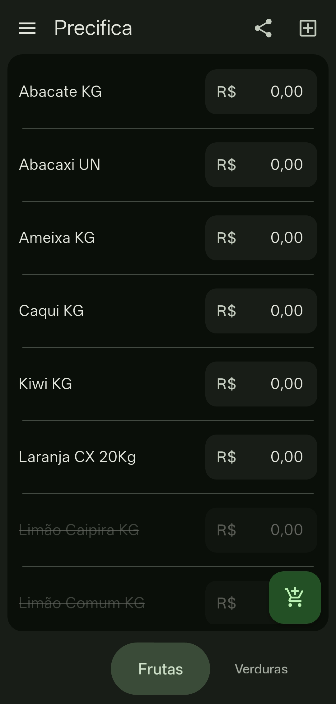
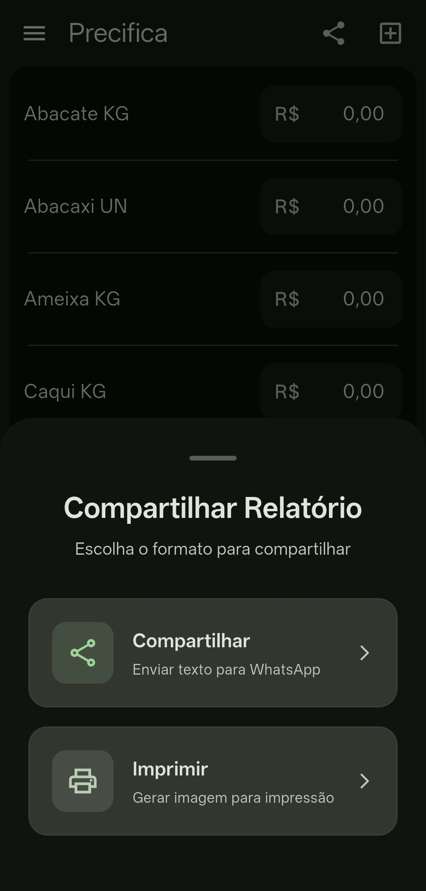
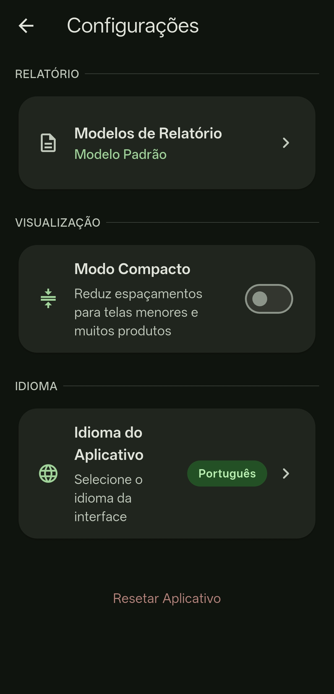
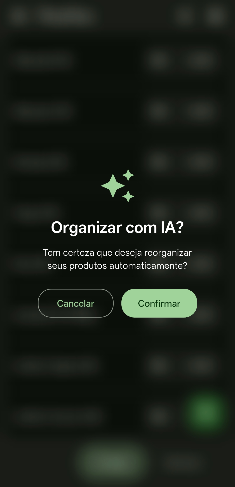

# Precifica [](https://flutter.dev) [](LICENSE) [](CONTRIBUTING.md)

**Precifica** é um aplicativo gratuito e open-source para gerenciamento de produtos e preços, focado em pequenos negócios como hortifrutis, mercearias e feiras. Organize listas, gere relatórios e compartilhe com seus clientes de forma simples e inteligente.

<br clear="left"/>

## Principais Funcionalidades

| Funcionalidade | Descrição |
|----------------|-----------|
| **Categorias e Produtos** | Crie categorias e adicione produtos com nome e preço |
| **Ativar/Desativar** | Toque em um produto para ativar ou desativar rapidamente |
| **Arrastar e Soltar** | Reorganize categorias arrastando-as para a posição desejada |
| **Organização com IA** | Reorganize automaticamente seus produtos em categorias usando Gemini AI |
| **Perfis** | Salve, carregue, importe e exporte configurações completas |
| **Relatórios** | Gere listas de preços formatadas para compartilhar via WhatsApp ou e-mail |
| **Modelos de Relatório** | Personalize título, formatação e filtros dos seus relatórios |

## Capturas de Tela

<table>
  <tr>
    <td align="center">
      <b>Tela Principal</b><br>
      
    </td>
    <td align="center">
      <b>Relatórios</b><br>
      
    </td>
    <td align="center">
      <b>Configurações</b><br>
      
    </td>
    <td align="center">
      <b>Organização com IA</b><br>
      
    </td>
  </tr>
</table>

## Começando

### Para Usuários

#### Download Direto
Baixe o APK mais recente na [página de releases](https://github.com/vinisebold/app-precifica/releases/latest).

#### Primeiro Acesso
1. Ao abrir pela primeira vez, siga o tutorial interativo
2. Crie sua primeira categoria e adicione produtos
3. Experimente o perfil de exemplo "Hortifruti" para ver o app em ação

### Para Desenvolvedores

#### Pré-requisitos
- Flutter SDK 3.4.0 ou superior
- Dart 3.0+
- Chave de API do [Google AI Studio](https://aistudio.google.com/apikey)

#### Configuração

1. Clone o repositório:
```bash
git clone https://github.com/vinisebold/app-precifica.git
cd precifica
```

2. Instale as dependências:
```bash
flutter pub get
```

3. Configure sua chave da API:
```bash
# Executar em modo debug
flutter run --dart-define=GEMINI_API_KEY=SUA_CHAVE_AQUI

# Gerar APK de release
flutter build apk --release --dart-define=GEMINI_API_KEY=SUA_CHAVE_AQUI
```

#### CI/CD com GitHub Actions

Adicione sua chave como secret no repositório (`GEMINI_API_KEY`) e use:

```yaml
- name: Build APK
  run: flutter build apk --release --dart-define=GEMINI_API_KEY=${{ secrets.GEMINI_API_KEY }}
```

## 📖 Guia de Uso

### Gerenciamento Básico

| Ação | Como Fazer |
|------|------------|
| **Adicionar Produto** | Toque no botão "+" na categoria desejada |
| **Editar Preço** | Toque no valor do preço para editar |
| **Ativar/Desativar** | Toque no produto para alternar o estado |
| **Reordenar Categorias** | Mantenha pressionado e arraste |
| **Excluir Item** | Deslize para o lado e confirme |

### Recursos Avançados

**Organização com IA**
1. Abra o menu lateral (☰)
2. Selecione "Organizar com IA"
3. Confirme a ação
4. Aguarde enquanto a IA reorganiza seus produtos em categorias inteligentes

**Perfis**
- **Salvar**: Menu → Salvar Perfil → Escolha um nome
- **Carregar**: Menu → Carregar Perfil → Selecione da lista
- **Exportar**: Menu → Exportar → Compartilhe o arquivo JSON
- **Importar**: Menu → Importar → Selecione o arquivo

**Relatórios**
1. Toque no ícone de compartilhar no topo
2. Escolha um modelo de relatório ou crie um novo
3. Personalize título, formatação e filtros
4. Compartilhe via WhatsApp, email ou outra plataforma

## Licença

```
Copyright 2024-2025 Os Contribuidores do Precifica

Licensed under the MIT License
You may obtain a copy of the License at

https://opensource.org/licenses/MIT

Unless required by applicable law or agreed to in writing, software
distributed under the License is distributed on an "AS IS" BASIS,
WITHOUT WARRANTIES OR CONDITIONS OF ANY KIND, either express or implied.
See the License for the specific language governing permissions and
limitations under the License.
```
